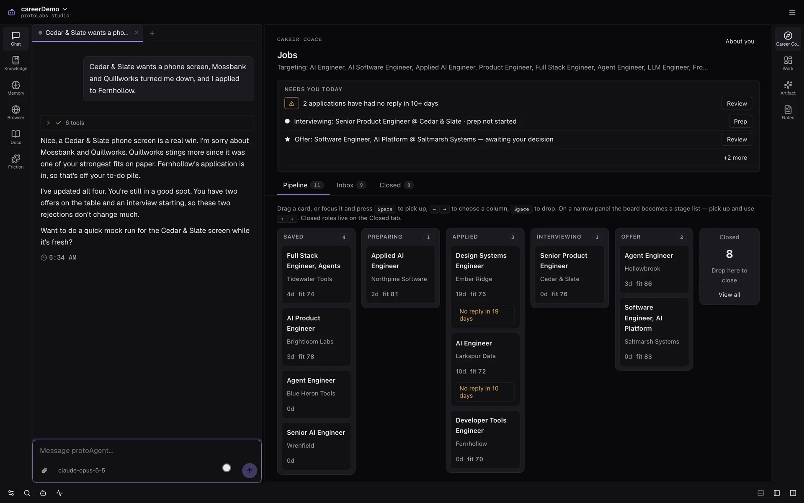

<p align="center">
  
</p>

<p align="center">
  <a href="https://github.com/protoLabsAI/careercoach-plugin/actions/workflows/ci.yml"></a>
  <a href="https://github.com/protoLabsAI/careercoach-plugin/releases/latest"></a>
  <a href="https://github.com/protoLabsAI/protoAgent"></a>
  
  <a href="LICENSE"></a>
</p>

# Career Coach

A career coach for your job search, built as a [protoAgent](https://github.com/protoLabsAI/protoAgent)
plugin. It helps you apply to fewer jobs, better: it researches the company, tells you honestly how well
you fit, and gets you past the blank page on a cover letter, an application answer or a counteroffer.

It never submits an application on its own, and it never makes up experience. You stay in charge of
what gets sent and where.

## What you get

- **A board for your search.** Every role you're tracking moves through Saved, Preparing, Applied,
  Interviewing and Offer. Drag a card, or tell the coach what happened and it updates the board for you.
- **New roles each morning.** It watches the job boards of companies you pick, sweeps the wider market,
  and puts fresh matches in an inbox you keep or dismiss. It warns you about likely ghost jobs.
- **An apply kit in about a minute.** A tailored résumé PDF, a cover letter when the posting asks for one,
  and drafted answers to the form's questions. You review it, paste it in and submit it yourself.
- **Practice before the real call.** Mock interviews with straight feedback. It catches the slip you'd
  regret on a real call, like naming the wrong employer, and swaps vague claims for your real numbers.
- **Help with the hard messages.** Follow-ups when an application goes quiet, a comparison of two offers
  with the math shown, and a counteroffer built on what you've actually done.
- **Honest feedback and a plan.** A real critique of your CV, and a skills-gap plan for the roles you're
  chasing.
- **It sounds like a person.** It reacts to your news, tells you what it thinks, and writes messages a
  human would send.
- **Nothing hidden.** The **About you** panel shows everything the coach knows about you, and what it
  still doesn't.

## How it stays honest

Everything it writes traces back to your profile. Things you've said never to claim stay out, including
softer wording that implies them. Every draft has to pass the interview test: could you explain this
line in an interview without backtracking? If you ask it to stretch the truth, it says no and writes the
strongest honest version instead.

By default it hands you an apply kit and you file the application. An opt-in beta can fill a live form,
but even then it can't click submit until you approve that one application. See
[Applying through ATS forms](docs/applying.md).

## Quick start

**Fastest:** in the protoAgent desktop app (v0.221.0 or later), create a new agent and pick
**Career Coach**. It installs the plugin and the coach persona for you.

**On an agent you already have:**

```sh
python -m server plugin install https://github.com/protoLabsAI/careercoach-plugin
```

Then turn it on in **Console → Plugins**, set your name, location and target roles in
**Settings → Career Coach**, and run **`/setup-coach`**. Setup works out what it already knows, asks only
about the gaps, and builds the profile everything else is anchored to. The full steps, including the
optional coach persona, are in [Install and setup](docs/install.md).

## Using it

| To | Say something like |
|---|---|
| Find roles | "Add Anthropic and Vercel to my watchlist." · "Find remote frontend roles." |
| Update the board | "Cedar & Slate wants a phone screen, and Mossbank turned me down." |
| Check a posting | "Here's a posting. Is it worth applying to?" |
| Build an apply kit | "Build my apply kit for the Tidewater Tools job." |
| Practice | "Mock interview me for the Cedar & Slate phone screen." |
| Follow up | "Ember Ridge hasn't replied in 18 days. Draft a follow-up." |
| Weigh offers | "Which offer should I take?" · "Draft my counter asking for $178k." |
| Plan | "What skills am I missing for these roles?" |

Or work it by hand in the **Career Coach** view in the console's rail. More in [Using it](docs/usage.md).

## Documentation

| Doc | What's in it |
|---|---|
| [Install and setup](docs/install.md) | Requirements, install, the persona, `/setup-coach`, optional extras |
| [Using it](docs/usage.md) | The view, the skills, things to try, the apply workflow, role packets |
| [How it works](docs/how-it-works.md) | The profile, the voice and write rules, job sources, the watch |
| [Applying through ATS forms](docs/applying.md) | The apply kit, the browser-fill beta, the submit gate |
| [Configuration](docs/configuration.md) | Every setting, its default, and what it does |
| [Tools](docs/tools.md) | Every agent tool |
| [Design decisions](docs/design-decisions.md) | Why it's built the way it is |
| [Development](docs/development.md) | Layout, tests, the plugin-system tour, releasing |
| [Upgrading](docs/upgrading.md) | Notes for versions that change behavior |

## Credits and license

MIT, see [LICENSE](LICENSE). The coaching prompts and writing rules are adapted with credit from
Mads Lorentzen's [ai-job-search](https://github.com/MadsLorentzen/ai-job-search) (MIT). Details are in
[CREDITS.md](CREDITS.md).
